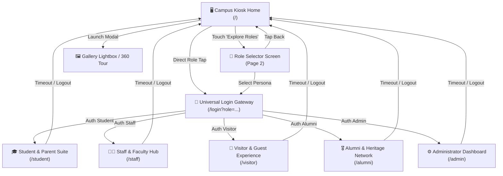
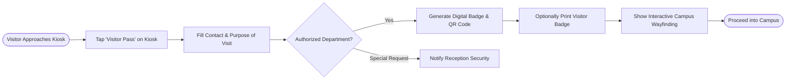

# 🏫 Smart Campus Kiosk & Role Portal — UI/UX Design System & Master Specification

> **Institutional Project**: Madhuvan Vatika Public School (MVPS) / Green Valley Public School  
> **Platform**: Standalone Touchscreen Campus Kiosk & Multi-Role Web Portal  
> **Framework**: Next.js 16 (App Router), React 19, TypeScript 5, Tailwind CSS v4, Lucide Icons  
> **Reference Hardware**: 1920 × 1080 (16:9 Widescreen Landscape), Full-Touch Capacitive Display  
> **Specification Version**: 2.5 (2026 Production Edition)

---

## 📑 Table of Contents

1. [Executive Overview & Design Vision](#1-executive-overview--design-vision)
2. [Kiosk Ergonomics & Hardware Interaction Model](#2-kiosk-ergonomics--hardware-interaction-model)
3. [Design Tokens & Core Design System](#3-design-tokens--core-design-system)
   - [3.1 Color Architecture & Persona Accents](#31-color-architecture--persona-accents)
   - [3.2 Typography System](#32-typography-system)
   - [3.3 Glassmorphism, Elevation & Shadows](#33-glassmorphism-elevation--shadows)
   - [3.4 Spacing & Container Hierarchy](#34-spacing--container-hierarchy)
   - [3.5 Motion, Timing & Micro-Interactions](#35-motion-timing--micro-interactions)
4. [Existing Architecture & Screen-by-Screen UX Breakdown](#4-existing-architecture--screen-by-screen-ux-breakdown)
   - [4.1 Screen 1: Smart Campus Kiosk Landing (`CampusInfoPortal.tsx`)](#41-screen-1-smart-campus-kiosk-landing-campusinfoportaltsx)
   - [4.2 Screen 2: Role Selection Command Screen (`RoleSelectionScreen.tsx`)](#42-screen-2-role-selection-command-screen-roleselectionscreentsx)
   - [4.3 Screen 3: Universal Role Authentication Gateway (`LoginScreen.tsx`)](#43-screen-3-universal-role-authentication-gateway-loginscreentsx)
   - [4.4 Screen 4: Visitor & Guest Experience Portal (`VisitorDashboard.tsx`)](#44-screen-4-visitor--guest-experience-portal-visitordashboardtsx)
   - [4.5 Screen 5: Student & Parent Academic Suite (`StudentDashboard.tsx`)](#45-screen-5-student--parent-academic-suite-studentdashboardtsx)
   - [4.6 Screen 6: Staff & Faculty Hub (`StaffDashboard.tsx`)](#46-screen-6-staff--faculty-hub-staffdashboardtsx)
   - [4.7 Screen 7: Administrator Command Center (`AdminDashboard.tsx`)](#47-screen-7-administrator-command-center-admindashboardtsx)
   - [4.8 Screen 8: Alumni & Heritage Network (`AlumniDashboard.tsx`)](#48-screen-8-alumni--heritage-network-alumnidashboardtsx)
5. [User Flowcharts & Interaction Architecture](#5-user-flowcharts--interaction-architecture)
6. [Component Design Library & Touch Targets](#6-component-design-library--touch-targets)
7. [Accessibility, Privacy & Environmental Hardening](#7-accessibility-privacy--environmental-hardening)
8. [UX Audit, Current Strengths & Enhancement Roadmap](#8-ux-audit-current-strengths--enhancement-roadmap)

---

## 1. Executive Overview & Design Vision

The **Smart Campus Kiosk & Role Portal** is an all-in-one digital operating terminal deployed at physical campus entrance lobbies, administrative corridors, and academic wings of **Madhuvan Vatika Public School (MVPS)**.

### Core Objectives
1. **Glanceable Public Information**: Provide immediate, high-impact visibility into live campus bulletins, board achievements, upcoming CBSE schedules, 360° virtual tours, and photo galleries without requiring login.
2. **Frictionless Role-Based Workspaces**: Enable one-tap switching between specialized portals for **Students & Parents**, **Staff & Faculty**, **Campus Visitors**, **School Administrators**, and **Alumni**.
3. **Touch-First Ergonomics**: Guarantee comfortable operation on 42"–65" large format touchscreen hardware, eliminating mouse/keyboard dependencies while providing on-screen touch keypads and large tap zones.
4. **Zero-Scroll Widescreen Containment**: Maintain a strict `100dvh` / `100vh` canvas layout where all primary controls and information cards fit neatly into the viewport with zero accidental window-level scrollbars.
5. **Warm Indian CBSE Institutional Branding**: Present a warm, welcoming, modern luxury aesthetic featuring soft cream/amber canvas tones, deep navy authority accents, vibrant role colors, and subtle glassmorphic depth.

---

## 2. Kiosk Ergonomics & Hardware Interaction Model

### 2.1 Target Canvas & Display Specifications
| Specification | Reference Standard | Responsive Boundary |
|---|---|---|
| **Native Aspect Ratio** | `16:9` Widescreen Landscape | Adapts smoothly to `16:10` and `21:9` |
| **Reference Resolution** | `1920 × 1080` (Full HD) | Fluid scaling between `1366 × 768` and `3840 × 2160` (4K) |
| **Viewport Rule** | Strict `100dvh` / `100vh` | `overflow: hidden` on root; internal card scrolling only |
| **Fullscreen Mode** | HTML5 Fullscreen API | Toggle trigger with automatic `fullscreenchange` listener |
| **Orientation Support** | Landscape First | Optimized for mounted horizontal kiosks |

### 2.2 Touch Ergonomics & Fitts's Law
- **Minimum Target Size**: All interactive buttons, tabs, and inputs meet or exceed **48 × 48 CSS pixels** (standard 56–68px on 1080p).
- **Target Spacing**: Minimum **12px to 16px** margins between adjacent controls to prevent accidental neighboring taps.
- **Reachability Zones**: Primary navigation controls and action buttons reside in the lower two-thirds of the screen, keeping them within comfortable reaching height for both adults and young students.
- **Touch Feedback**: Every touchable component implements immediate visual depression (`transform: scale(0.97)` to `0.98`), background tinting, or border illumination within **50ms**.
- **No Hover Dependence**: No critical information or tooltips rely on hover states; all data is displayed directly or accessible via tap modals.

### 2.3 Environmental & Lighting Adaptation
- **Ambient Light Legibility**: High contrast ratios (minimum 4.5:1 for body copy; 7:1 for headers) against soft warm backgrounds ensure readability under fluorescent hallway lights or sunlight-exposed entrance atriums.
- **Anti-Distortion Image Rules**:
  - `object-fit: cover` for full-bleed showcase banners and event photography.
  - `object-fit: contain` for school crests, logos, and QR codes.
  - Layered multi-stop dark gradient overlays (`rgb(0 0 0 / 75%)` to `transparent`) guarantee crisp text legibility over photo backgrounds.

---

## 3. Design Tokens & Core Design System

### 3.1 Color Architecture & Persona Accents

The system utilizes a central warm amber-cream theme with dedicated semantic colorways for each user persona:

```css
/* Core Global Canvas & Neutral Tokens */
:root {
  --primary-navy: #0e2a47;        /* Authority, institution headers */
  --school-green: #0d5f47;        /* Nature, sustainability */
  --text-dark: #1e293b;           /* High-contrast charcoal text */
  --text-muted: #64748b;          /* Secondary captions, subtitles */
  --canvas-bg: #fffaf4;           /* Warm ivory background */
  --canvas-gradient: linear-gradient(135deg, #fffcf9 0%, #fff6ed 45%, #ffede0 100%);
  --glass-bg: rgba(255, 255, 255, 0.92);
  --glass-border: rgba(255, 255, 255, 0.75);
  --glass-shadow: 0 10px 25px -5px rgba(0, 30, 60, 0.08), 0 8px 10px -6px rgba(0, 30, 60, 0.04);
}
```

#### Persona-Specific Color Matrix
| Persona | Accent Hex | Soft Hex | Gradient Fill | Meaning & Role Tone |
|---|---|---|---|---|
| **Student & Parent** | `#ea580c` | `#fff7ed` | `linear-gradient(135deg, #ea580c, #c2410c, #f59e0b)` | Dynamic, energizing, youthful curiosity |
| **Staff & Faculty** | `#0d9488` | `#f0fdfa` | `linear-gradient(135deg, #0d9488, #0f766e, #14b8a6)` | Calm, balanced, professional mentorship |
| **Visitor & Guest** | `#7c3aed` | `#f5f3ff` | `linear-gradient(135deg, #7c3aed, #6d28d9, #8b5cf6)` | Welcoming, regal, sophisticated hospitality |
| **Alumni & Ex-Staff** | `#d97706` | `#fffbeb` | `linear-gradient(135deg, #d97706, #b45309, #f59e0b)` | Golden heritage, prestige, nostalgia |
| **Administrator** | `#0e2a47` | `#eff6ff` | `linear-gradient(135deg, #0e2a47, #1e3a8a, #2563eb)` | Executive governance, institutional trust |

---

### 3.2 Typography System

The application loads curated Google Fonts providing an academic yet modern digital aesthetic:
- **`Plus Jakarta Sans`**: Primary typeface for UI controls, navigation, tables, and body copy.
- **`Outfit`**: Display typeface for numerical data, countdowns, timestamps, and prominent headlines.
- **`Caveat`**: Handwritten script font used selectively for inspirational educator quotes and slogans.

```css
/* Typography Scale (Fluid clamp scaling for 1080p kiosk screens) */
--font-display-xl: clamp(1.8rem, 2.8vw, 2.8rem); /* Screen Hero titles */
--font-title-lg:   clamp(1.2rem, 1.8vw, 1.7rem); /* Card Headings */
--font-title-md:   clamp(1.0rem, 1.3vw, 1.25rem);/* Subheaders & Section Titles */
--font-body:       clamp(0.85rem, 0.95vw, 1.0rem);/* Standard Paragraphs & Table Rows */
--font-caption:    clamp(0.72rem, 0.8vw, 0.85rem);/* Badges, Sub-labels, Metadata */
--font-micro:      clamp(0.62rem, 0.68vw, 0.72rem);/* Tickers & Fine Print */
```

---

### 3.3 Glassmorphism, Elevation & Shadows

The design avoids flat boxes and heavy drop-shadows by utilizing **multi-layered frosted glassmorphism**:
- **Layer 0 (Background Canvas)**: Radial mesh gradients with subtle dot-grid background texture.
- **Layer 1 (Bento Grid Tiles)**: `background: rgba(255, 255, 255, 0.88)`, `backdrop-filter: blur(12px)`, `border: 1.5px solid rgba(255, 255, 255, 0.85)`, subtle shadow `0 8px 24px rgba(234, 88, 12, 0.06)`.
- **Layer 2 (Interactive Floating Cards & Badges)**: Soft inner glows, border color highlights matching the persona accent, hover elevation `transform: translateY(-2px)`.
- **Layer 3 (Modals, Lightboxes & Command Header)**: `background: rgba(255, 255, 255, 0.96)`, `backdrop-filter: blur(24px)`, heavy diffused shadow `0 24px 60px rgba(14, 42, 71, 0.18)`.

---

### 3.4 Spacing & Container Hierarchy

The UI adheres to a strict 8-point spatial rhythm:
- Spacing steps: `4px`, `8px`, `12px`, `16px`, `24px`, `32px`, `48px`.
- Card border radiuses:
  - Small pills & badges: `9999px` (Full pill).
  - Feature cards & inputs: `16px` to `20px`.
  - Main containers & modal dialogs: `24px` to `32px`.

---

### 3.5 Motion, Timing & Micro-Interactions

| Interaction | Duration | Easing Function | Description |
|---|---|---|---|
| **Button Tap / Press** | `120ms` | `ease-out` | Micro-scale reduction (`0.97`) with immediate response |
| **Tab Switch / Screen Transition** | `240ms` | `cubic-bezier(0.16, 1, 0.3, 1)` | Fade-in with 8px vertical upward slide |
| **Modal Lightbox Open/Close** | `280ms` | `cubic-bezier(0.16, 1, 0.3, 1)` | Scale-in from `0.94` with backdrop blur fade |
| **Campus Live Ticker** | Continuous | `linear` | Infinite marquee scroll (`45s` cycle) with pause on tap |
| **Live Status Indicator** | `1800ms` | `ease-in-out` | Pulsing green glowing aura (`@keyframes pulse`) |

---

## 4. Existing Architecture & Screen-by-Screen UX Breakdown

```text
Kiosk Application Route Structure
├── / (Home Campus Kiosk)
│   ├── View A: CampusInfoPortal.tsx  (Asymmetrical Bento Grid & Public Showcase)
│   └── View B: RoleSelectionScreen.tsx (Persona Discovery Hub)
├── /login?role=[role] (LoginScreen.tsx — Universal Gateway with Virtual Keypad)
├── /student (StudentDashboard.tsx — Academic & Progress Hub)
├── /staff (StaffDashboard.tsx — Faculty Management Hub)
├── /visitor (VisitorDashboard.tsx — Guest Pass, Wayfinding & Admissions)
├── /admin (AdminDashboard.tsx — Executive Command & Kiosk Diagnostics)
└── /alumni (AlumniDashboard.tsx — Legacy, Hall of Fame & Networking)
```

---

### 4.1 Screen 1: Smart Campus Kiosk Landing (`CampusInfoPortal.tsx`)

#### Purpose & Goal
Public-facing landing screen greeting visitors, students, and staff entering campus. Provides immediate status updates, achievements, virtual tours, and one-tap entry into roles.

#### Structural Zones
1. **Floating Command Header Bar**:
   - **School Brand Crest & Identity**: Custom vector SVG crest with "Madhuvan Vatika - MVPS", motto *"Learn • Grow • Excel"*, and CBSE affiliation code `1930281`.
   - **Center Marquee Capsule**: Real-time ticker broadcasting board distinctions, admission notices, sports day schedules, and robotics wins.
   - **Kiosk Online Status & Clock**: Real-time ticking date & clock pill with green pulsing dot; fullscreen trigger icon button.
2. **Zone A (Left - Cinematic Showcase & Quick Roles)**:
   - **Hero Video Showcase**: Auto-looping 20-second promo video (`/Madhuvan_Vatika_Public_School_Full_Promo_20s.mp4`) with video fallback poster (`/hero_school_building.jpg`), high-contrast text overlay, and quick action CTA button.
   - **Quick Role Launcher Ribbon**: Horizontal cluster of 4 direct touch buttons (Student, Staff, Visitor, Alumni) enabling instant role selection without digging into menus.
3. **Zone B (Right - Asymmetrical Bento Grid)**:
   - **Interactive Schedule / Calendar Card**: Filterable tabs for CBSE Board, STEM, Sports, and Cultural events with date badges and venue details.
   - **Campus Milestones & Accolades Card**: Interactive card opening the full Awards modal.
   - **360° Virtual Campus Tour Tile**: Instant modal launch previewing laboratories, sports grounds, and libraries.
   - **Photo & Video Showcase Carousel**: Multi-item gallery with left/right touch arrows and full-screen lightbox modal.
   - **Floating AI Assistant Bot**: Quick access widget for automated campus queries.

---

### 4.2 Screen 2: Role Selection Command Screen (`RoleSelectionScreen.tsx`)

#### Purpose & Goal
A dedicated transition page allowing users to inspect the capabilities of each role before authenticating.

#### Key UX Features
- **4 Prominent Persona Cards**:
  1. *Student / Parent* (Orange accent `#ea580c`): Homework, report cards, fee tracking.
  2. *Staff* (Teal accent `#0d9488`): Attendance marking, gradebook, timetable.
  3. *Visitor* (Violet accent `#7c3aed`): Digital pass, campus tour, admissions desk.
  4. *Alumni / Ex-Staff* (Gold accent `#d97706`): Directory, mentorship, hall of fame.
- **3D Persona Avatars**: High-definition transparent 3D illustrations representing each user group.
- **Back Navigation**: Prominent top-left arrow returning immediately to the main kiosk landing screen.

---

### 4.3 Screen 3: Universal Role Authentication Gateway (`LoginScreen.tsx`)

#### Purpose & Goal
Unified, high-security authentication gateway supporting credentials and smart card identification.

#### Key UX Features
- **Adaptive Persona Branding**: Background aura, title headers, and badges dynamically morph to match the selected role's colorway.
- **Role Switching Ribbon**: Top pill tabs allowing instant switching of login targets without returning to home.
- **Touch-Friendly Form Controls**:
  - Extra-large input fields (`54px` height) with embedded icons.
  - Native password peek toggle button (`Eye` / `EyeOff`) with Edge duplicate reveal prevention.
  - Remember Me toggle switch for authorized staff terminals.
- **On-Screen Touch Virtual Keypad**:
  - Full numeric and alphanumeric keypad for quick PIN/ID entry directly on touchscreens without requiring physical peripheral keyboards.
- **Server Settings Drawer**:
  - Hidden diagnostic drawer allowing campus IT administrators to configure backend VAPS API endpoints or activate offline demonstration modes.
- **Pedagogical Slogans**: Rotating inspirational quotes from Dr. A.P.J. Abdul Kalam, Swami Vivekananda, and Nelson Mandela.

---

### 4.4 Screen 4: Visitor & Guest Experience Portal (`VisitorDashboard.tsx`)

#### Purpose & Goal
Self-service concierge kiosk for prospective parents, vendors, guest lecturers, and campus visitors.

#### Core Sub-Modules
1. **Express Visitor Pass & Check-In**:
   - Digital registration collecting visitor name, phone number, purpose of visit, and host department.
   - Live badge preview with auto-generated QR code and instant print action.
2. **Interactive Campus Wayfinding & 3D Building Navigator**:
   - Filterable directory of school blocks (Vivekananda Block, Kalam STEM Center, Sports Complex, Administrative Wing).
   - Walking distances in meters, floor levels, and elevator accessibility guides.
3. **Admissions 2026-27 Information Desk**:
   - Grade eligibility matrix (Nursery to Grade XII), fee breakdown summary, and digital prospectus inquiry.
4. **Principal & Faculty Appointment Desk**:
   - Scheduled visiting hour matrix and appointment request submission.
5. **Ask-CBSE AI Virtual Concierge**:
   - Interactive Q&A covering curriculum guidelines, uniform policies, and school transport routes.

---

### 4.5 Screen 5: Student & Parent Academic Suite (`StudentDashboard.tsx`)

#### Purpose & Goal
Comprehensive academic tracker empowering students and parents to review daily progress, fees, attendance, and assignments.

#### Core Sub-Modules
1. **Identity & Session Header**: Displays student photo, admission number, grade/section, and academic year.
2. **Live Attendance Meter**:
   - Circular percentage progress gauge with color-coded warning indicators (Green ≥ 85%, Amber 75–84%, Red < 75%).
   - Calendar grid highlighting present, absent, and holiday dates.
3. **Daily Timetable & Period Countdown**:
   - Visual timeline displaying current ongoing subject, teacher name, classroom number, and countdown to next bell.
4. **Exam Results & Report Card Analytics**:
   - Term-wise subject scores, class rank percentiles, and printable report cards.
5. **Fee Ledger & Payment Receipts**:
   - Real-time tuition dues, installment schedules, and digital PDF receipt downloads.
6. **Homework & LMS Submissions**:
   - Subject-wise homework cards with due dates and submission status badges.

---

### 4.6 Screen 6: Staff & Faculty Hub (`StaffDashboard.tsx`)

#### Purpose & Goal
Faculty command center streamlining administrative workflows so educators can focus on teaching.

#### Core Sub-Modules
1. **Teacher Daily Schedule**: Assigned periods, room substitutions, and laboratory sessions.
2. **Biometric Punch-Log Integration**:
   - In/Out punch timestamps, daily working hours calculation, and monthly punch summary.
3. **Leave Management Workflow**:
   - Available casual, medical, and earned leave balances with one-tap digital application submission.
4. **Digital Gradebook**:
   - Quick mark entry for periodic assessments, class tests, and board evaluations.
5. **Staff Salary & Payslip Explorer**:
   - Monthly earnings breakdown, deductions, and downloadable salary statements.

---

### 4.7 Screen 7: Administrator Command Center (`AdminDashboard.tsx`)

#### Purpose & Goal
Executive dashboard for school directors, principals, and IT kiosk administrators.

#### Core Sub-Modules
1. **Campus Vital Metric Cards**: Real-time student attendance %, staff check-in rate, collected fee totals, and active kiosk terminals.
2. **Emergency Broadcast Transmitter**: One-touch broadcast system for urgent campus alerts (weather warnings, schedule adjustments).
3. **Kiosk Diagnostics & Hardware Watchdog**: Latency ping to external VAPS servers, memory consumption, and active session timers.

---

### 4.8 Screen 8: Alumni & Heritage Network (`AlumniDashboard.tsx`)

#### Purpose & Goal
Fostering lifelong connections with graduates and former faculty of MVPS.

#### Core Sub-Modules
1. **Alumni Directory**: Searchable directory by graduation batch, profession, and country.
2. **Hall of Fame**: Spotlights honoring notable alumni in STEM, civil services, sports, and arts.
3. **Mentorship Program Registry**: Connects senior alumni with high school students for career guidance.
4. **Heritage Archive**: Historic campus photographs, yearbooks, and annual day recordings.

---

## 5. User Flowcharts & Interaction Architecture

### 5.1 High-Level Navigation Architecture



---

### 5.2 Visitor Self-Service Check-In Flow



---

## 6. Component Design Library & Touch Targets

### 6.1 Interactive Button Matrix
| Button Variant | Min Height | Padding | Styling & Visual Treatment | State Feedback |
|---|---|---|---|---|
| **Primary Action** | `52px` | `0 24px` | Gradient fill (`#ea580c` to `#c2410c`), white text, bold `600`, pill radius `9999px` | Scale down to `0.97`, shadow increases |
| **Glass Secondary** | `48px` | `0 20px` | `rgba(255, 255, 255, 0.85)`, border `1.5px solid rgba(234, 88, 12, 0.25)`, text `--primary-navy` | Background tints to light orange |
| **Pill Filter Tab** | `42px` | `0 16px` | Neutral slate border; active tab gains solid persona accent + white text | Smooth slide indicator |
| **Fullscreen Toggle** | `46 × 46px` | Center | Circular glass button with subtle border and icon swap (`Maximize` / `Minimize`) | Glow ring on tap |

### 6.2 Touch Input Fields & On-Screen Keypad
- **Input Containers**: Height `52px`, rounded corners `14px`, background `rgba(255, 255, 255, 0.95)`, border `1.5px solid #cbd5e1`.
- **Focus State**: Border color shifts to `--role-accent` (`#ea580c`), soft outer halo ring (`box-shadow: 0 0 0 4px rgba(234, 88, 12, 0.15)`).
- **Virtual Numeric Keypad**: Key targets `64 × 64px` with clear sans-serif numerals, haptic-style depression animation, and dedicated backspace/clear keys.

---

## 7. Accessibility, Privacy & Environmental Hardening

### 7.1 WCAG 2.1 Level AA Compliance
- **Color Contrast**: All normal text maintains a contrast ratio of at least **4.8:1** against backgrounds; large titles exceed **7:1**.
- **No Color-Alone States**: Status alerts combine distinctive colored badges with explicit text and Lucide icons (e.g., Green Checkmark for Present, Red AlertTriangle for Absent).
- **Scalable Typography**: All text sizes utilize relative units (`rem`, `clamp`) ensuring compatibility with browser zoom or system accessibility adjustments.

### 7.2 Public Kiosk Privacy & Security Controls
1. **Inactivity Session Watchdog**:
   - If an authenticated dashboard remains untouched for **120 seconds**, a 15-second countdown warning modal appears.
   - If no tap is registered, the session is cleared (`clearUserSession()`) and the terminal returns automatically to `/`.
2. **Public Credential Sanitization**:
   - Password fields never retain entered plaintext in memory.
   - Browser auto-fill and password management popups are suppressed via HTML attributes (`autoComplete="new-password"`, `spellCheck="false"`).
3. **Watchdog Crash Recovery**:
   - Unhandled client runtime errors trigger an automated recovery boundary that re-mounts the safe kiosk landing screen without showing raw stack traces to the public.

---

## 8. UX Audit, Current Strengths & Enhancement Roadmap

### 8.1 Key Strengths of Current Implementation
- ✅ **Zero-Scroll Strict Viewport**: Perfectly contained within 100dvh without awkward outer scrollbars.
- ✅ **Vibrant, Warm Visual Identity**: Moves beyond generic blue dashboards into a customized, warm Indian school aesthetic.
- ✅ **Integrated Hardware Fullscreen API**: Works seamlessly in Google Chrome kiosk mode (`--kiosk`).
- ✅ **Rich Contextual Content**: Real CBSE schedules, authentic student/staff mock data, and full promo video background.

### 8.2 Prioritized Enhancement Roadmap
| Phase | Feature | UX Impact | Implementation Target |
|---|---|---|---|
| **Phase 1** | **Multi-Language Selector** | Enable Hindi, Punjabi, and English UI toggles for diverse community accessibility | Floating language pill in command header |
| **Phase 2** | **RFID / NFC Card Tap Integration** | Instant card tap login for students and staff without typing credentials | Web USB / Serial API card reader listener |
| **Phase 3** | **Voice Navigation Concierge** | Hands-free voice querying for visually impaired visitors or young learners | Web Speech Recognition API integration |
| **Phase 4** | **High-Contrast Dark / Outdoor Mode** | Extreme contrast mode for high-glare direct sunlight installation spots | CSS media query & manual toggle |

---

*Document compiled and maintained by the Digital Campus Engineering & UI/UX Team.*
